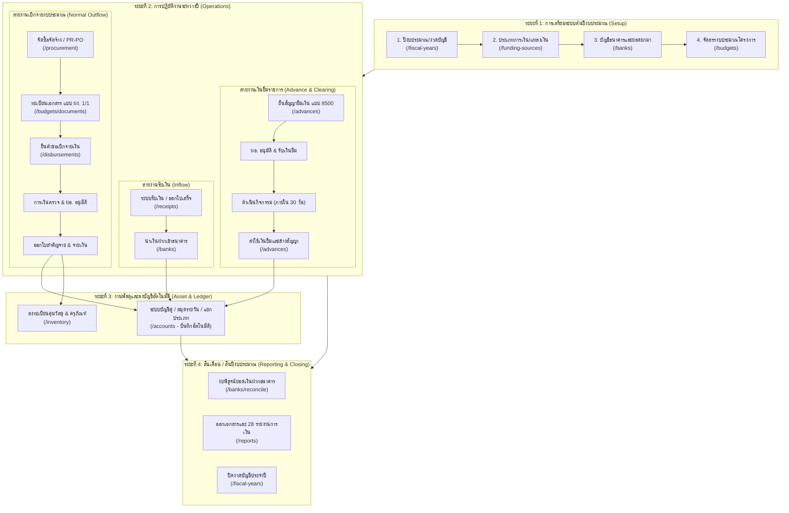

# คู่มือขั้นตอนการใช้งานระบบบริหารการเงินและบัญชีสถานศึกษา
### โรงเรียนละลมวิทยา (Lalompittayakhom School)

> คู่มือฉบับนี้อธิบายลำดับขั้นตอนการปฏิบัติงานทางการเงินและบัญชีอย่างเป็นขั้นตอน เพื่อให้ผู้ใช้งานทุกระดับ (ผู้อำนวยการ, เจ้าหน้าที่การเงิน, เจ้าหน้าที่บัญชี, เจ้าหน้าที่พัสดุ และครูผู้ขอเบิก) เข้าใจว่า **"ต้องเริ่มต้นจากเมนูไหนก่อน เมื่อทำเสร็จแล้วต้องส่งต่อไปที่เมนูใด"**

---

## 1. แผนผังภาพรวมวงจรการเงินสถานศึกษา (Financial Lifecycle Workflow)



---

## 2. ลำดับขั้นตอนการทำงาน (Step-by-Step Guide)

ระบบบริหารการเงินและบัญชีถูกออกแบบให้แต่ละโมดูลเชื่อมโยงกันอย่างเป็นระบบ โดยแบ่งเป็น **4 ขั้นตอนหลัก** ดังนี้:

---

### ขั้นตอนที่ 1: การตั้งค่าเริ่มต้นต้นปีงบประมาณ (ทำครั้งเดียวตอนต้นปี)

ก่อนที่ครูหรือเจ้าหน้าที่จะทำเรื่องเบิกจ่ายเงินได้ จะต้องตั้งค่าฐานข้อมูลให้พร้อมใช้งานตามลำดับดังนี้:

| ลำดับ | เมนูที่ต้องเข้า | ผู้รับผิดชอบ | สิ่งที่ต้องทำในเมนูนี้ | เมื่อเสร็จแล้วไปไหนต่อ |
|:---:|---|---|---|---|
| **1.1** | **ปีงบประมาณ/งวดบัญชี**<br>`/fiscal-years` | แอดมิน / เจ้าหน้าที่บัญชี | - สร้างปีงบประมาณใหม่ เช่น พ.ศ. 2570<br>- กำหนดสถานะเป็น **"ปีปัจจุบัน (Active)"**<br>- ระบบจะเปิดงวดบัญชี 12 เดือนให้อัตโนมัติ | ไปที่เมนู **ประเภทการเงิน** |
| **1.2** | **ประเภทการเงิน**<br>`/funding-sources` | เจ้าหน้าที่การเงิน | - กำหนดหมวดหมู่แหล่งเงิน เช่น เงินอุดหนุนรายหัว, เงินรายได้สถานศึกษา, เงินเรียนฟรี 15 ปี, เงินอาหารกลางวัน | ไปที่เมนู **ธนาคารและกระทบยอด** |
| **1.3** | **ธนาคารและกระทบยอด**<br>`/banks` | เจ้าหน้าที่การเงิน | - บันทึกบัญชีเงินฝากของโรงเรียน (กรุงไทย, ออมสิน ฯลฯ)<br>- ใส่เลขที่บัญชี และยอดยกมาจากปีก่อนหน้า | ไปที่เมนู **บริหารงบประมาณ** |
| **1.4** | **บริหารงบประมาณ**<br>`/budgets` | เจ้าหน้าที่แผนงาน / การเงิน | - นำแผนปฏิบัติการประจำปีมากรอกจัดสรรเงินตามโครงการและกิจกรรม<br>- กำหนดวงเงินงบประมาณสุทธิของแต่ละกิจกรรม | **ระบบพร้อมเปิดใช้งานสำหรับบุคลากรทั้งโรงเรียน** |

> [!IMPORTANT]
> หากยังไม่ได้กำหนดปีงบประมาณหรือจัดสรรงบประมาณในข้อ 1.4 จะไม่สามารถยื่นขอเบิกจ่ายหรือยืมเงินในระบบได้

---

### ขั้นตอนที่ 2: วงจรการปฏิบัติงานประจำวัน (Day-to-Day Operations)

เมื่อมีเหตุการณ์ทางการเงินเกิดขึ้น ให้เลือกปฏิบัติตาม **3 วงจรหลัก** ด้านล่าง:

#### 🔹 วงจร A: เมื่อโรงเรียนได้รับเงินเข้ามา (การรับเงิน)
```
[เมนู: ระบบรับเงิน] ──(ออกใบเสร็จ)──> [เมนู: ธนาคาร] ──(ทำใบนำฝาก)──> [ระบบลงบัญชีคู่อัตโนมัติ]
```
1. **ไปที่เมนู:** `ระบบรับเงิน (/receipts)`
   - กดปุ่ม **"ออกใบเสร็จรับเงินใหม่"**
   - เลือกว่าเป็นเงินประเภทใด (เงินอุดหนุน, เงินบริจาค, ค่าบำรุงการศึกษา ฯลฯ)
   - ระบุผู้ชำระเงิน จำนวนเงิน และรูปแบบ (เงินสด หรือ เงินโอน)
2. **ขั้นตอนถัดไป:** เมื่อได้รับเงินแล้ว ให้นำส่งเข้าบัญชีธนาคารโรงเรียน
   - กดปุ่ม **"จัดทำใบนำฝากเงิน"** นำเข้าบัญชีในเมนู `ธนาคารและกระทบยอด (/banks)`
   - ระบบจะไปเพิ่มยอดเงินในบัญชีธนาคาร และบันทึกสมุดรายวันทั่วไปให้โดยอัตโนมัติ

---

#### 🔹 วงจร B: การเบิกจ่ายเงินงบประมาณปกติ (ซื้อของ/จ้างงาน/จัดกิจกรรม)
```
[1. จัดซื้อจัดจ้าง] ──> [2. ทะเบียนเอกสาร ผง.] ──> [3. ยื่นขอเบิกจ่าย] ──> [4. อนุมัติ & จ่ายเงิน]
```
1. **กรณีมีการซื้อของหรือจ้างงาน (ถ้ามี):**
   - เริ่มที่เมนู `จัดซื้อจัดจ้าง (/procurement)` -> ทำใบขอซื้อขอจ้าง (PR) -> ออกใบสั่งซื้อสั่งจ้าง (PO) -> รายงานตรวจรับพัสดุ
2. **ทำบันทึกขออนุมัติงบประมาณ:**
   - ไปที่เมนู `ทะเบียนเอกสาร ผง. (/budgets/documents)`
   - เลือกกิจกรรม/โครงการ -> พิมพ์ **แบบ ผง. 1/1 (บันทึกขออนุมัติเงินงบประมาณ)** เสนอ ผอ. ลงนาม
3. **ยื่นคำขอเบิกเงินในระบบ:**
   - ไปที่เมนู `เบิกจ่ายเงิน (/disbursements)` -> กด **"สร้างคำขอเบิกจ่าย"**
   - แนบหลักฐานใบเสร็จ/ใบสำคัญรับเงิน -> บันทึกส่งตรวจ (Submitted)
4. **กระบวนการอนุมัติและการจ่ายเงิน:**
   - **การเงิน/บัญชี:** ตรวจสอบความถูกต้องของเอกสาร -> กด **"ตรวจสอบแล้ว (Verified)"**
   - **ผู้อำนวยการ:** ตรวจสอบยอดเงิน -> กด **"อนุมัติ (Approved)"**
   - **การเงิน:** จัดทำใบสำคัญจ่าย (Payment Voucher - PV) เลือกจ่ายจากเงินสดหรือบัญชีธนาคาร -> กด **"บันทึกจ่ายเงินแล้ว (Paid)"**
5. **สิ่งที่ระบบทำให้อัตโนมัติหลังจ่ายเงิน:**
   - ตัดยอดงบคงเหลือในโครงการ (`/budgets`) ทันที
   - ตัดยอดยกไปในบัญชีธนาคาร (`/banks`) ทันที
   - บันทึกบัญชีเดบิตค่าใช้จ่าย / เครดิตเงินฝากธนาคารใน `บัญชีและสมุดรายวัน (/accounts)` ทันที

---

#### 🔹 วงจร C: การขอยืมเงินราชการไปจัดกิจกรรม (เงินยืมและการล้างยืม)
```
[1. ยื่นสัญญายืมเงิน] ──> [2. ผอ. อนุมัติ & รับเงิน] ──> [3. จัดกิจกรรม] ──> [4. ส่งใช้ใบสำคัญล้างยืม]
```
1. **ยื่นสัญญายืมเงิน:**
   - ครูผู้รับผิดชอบโครงการไปที่เมนู `เงินยืมและล้างยืม (/advances)`
   - กด **"สร้างสัญญายืมเงินใหม่"** (ระบบสร้างเลขที่สัญญาตาม แบบ 8500)
   - ระบุโครงการ วัตถุประสงค์ จำนวนเงิน และวันที่ครบกำหนดส่งใช้ (ตามระเบียบไม่เกิน 30 วัน)
2. **อนุมัติและรับเงิน:**
   - ผู้อำนวยการตรวจสอบและอนุมัติสัญญา -> การเงินจ่ายเงินยืมให้ผู้ขอยืม
   - สถานะสัญญาเปลี่ยนเป็น **"ยืมเงินแล้ว (Disbursed)"** (ยอดจะปรากฏบนแดชบอร์ดเตือน)
3. **นำเงินไปดำเนินกิจกรรมและเก็บหลักฐาน:**
   - จัดกิจกรรมตามโครงการ พร้อมรวบรวมใบเสร็จรับเงิน/ใบสำคัญรับเงิน
4. **ส่งใช้เงินยืมและล้างสัญญา (Clearing):**
   - เมื่อเสร็จสิ้นกิจกรรม ให้กลับมาที่เมนู `เงินยืมและล้างยืม (/advances)` -> เลือกสัญญาเดิม -> กด **"ส่งใช้เงินยืม (Clear Advance)"**
   - กรอกรายการค่าใช้จ่ายจริงที่เกิดขึ้น:
     - **กรณีใช้เงินพอดี:** แนบใบสำคัญครบตามยอด -> ล้างสัญญาเรียบร้อย
     - **กรณีมีเงินเหลือ:** ระบุยอดเงินเหลือส่งคืน -> นำเงินสด/สลิปโอนคืนการเงิน
     - **กรณีจ่ายเกินจริง:** ระบบจะสร้างคำขอเบิกจ่ายส่วนต่างเพิ่มให้อัตโนมัติ
   - เจ้าหน้าที่การเงินตรวจรับใบสำคัญ -> กดยืนยันปิดสัญญา (Settled)

> [!WARNING]
> หากสัญญายืมเงินครบกำหนด 30 วันแล้วยังไม่ส่งใช้เงินยืม ระบบจะเปลี่ยนสถานะเป็น **"เกินกำหนด (Overdue)"** และมีสัญญาณไฟกระพริบเตือนสีแดงบนหน้าแดชบอร์ดของผู้บริหารและการเงินทันที

---

### ขั้นตอนที่ 3: งานพัสดุ ครุภัณฑ์ และบัญชีคู่ (Asset & Accounting)

เมื่อมีการเบิกจ่ายเงินซื้อพัสดุหรือครุภัณฑ์ ให้ส่งต่อข้อมูลดังนี้:

1. **บันทึกลงทะเบียนคุมพัสดุและครุภัณฑ์:**
   - ไปที่เมนู `พัสดุและครุภัณฑ์ (/inventory)`
   - **ถ้าเป็นวัสดุสิ้นเปลือง:** นำรายการมาบันทึกลงใน **บัญชีคุมวัสดุ (Stock Card)** เพื่อใช้ควบคุมการเบิกจ่ายของครูในโรงเรียน
   - **ถ้าเป็นครุภัณฑ์ (มูลค่าตั้งแต่เกณฑ์ที่กำหนด):** ลงทะเบียนคุมทรัพย์สิน (พณ.1) ระบบจะคำนวณ **ค่าเสื่อมราคาแบบเส้นตรง (Straight-Line Depreciation)** ให้อัตโนมัติทุกสิ้นปีงบประมาณ
2. **ตรวจสอบความถูกต้องทางบัญชี:**
   - ไปที่เมนู `บัญชีและสมุดรายวัน (/accounts)`
   - ตรวจดู **สมุดรายวันทั่วไป (General Journal)**
   - ตรวจดู **บัญชีแยกประเภท (General Ledger)**
   - ตรวจดู **งบทดลอง (Trial Balance)** ต้องมียอด $\text{Debit} = \text{Credit}$ ดุลกันเสมอ

---

### ขั้นตอนที่ 4: งานสิ้นเดือนและสิ้นปีงบประมาณ (Closing & Reporting)

เมื่อถึงสิ้นเดือนหรือสิ้นปีงบประมาณ ให้ดำเนินการปิดงวดและรายงานผลตามลำดับ:

```
[1. ตรวจสอบสเตตเมนต์] ──> [2. ทำงบพิสูจน์ยอดธนาคาร] ──> [3. พิมพ์ 28 รายงาน] ──> [4. ปิดงวดบัญชี]
```

1. **ทำงบพิสูจน์ยอดเงินฝากธนาคาร:**
   - นำ Statement จากธนาคารมาเทียบกับสมุดบัญชีโรงเรียน
   - ไปที่เมนู `ธนาคารและกระทบยอด (/banks)` -> เลือก **"งบพิสูจน์ยอด (Reconciliation)"**
   - ตรวจสอบเช็คค้างจ่าย หรือเงินฝากระหว่างทาง เพื่อให้ยอดตรงกัน 100%
2. **พิมพ์เอกสารและรายงานราชการ:**
   - ไปที่เมนู `เอกสารและ 28 รายงาน (/reports)`
   - เลือกรายงานที่ต้องการพิมพ์ส่งหน่วยงานต้นสังกัด เช่น:
     - `REC-01` รายงานเงินคงเหลือประจำวัน (บก.111)
     - `PAY-01` ทะเบียนคุมการเบิกจ่ายเงินงบประมาณ
     - `ADV-02` รายงานลูกหนี้เงินยืมค้างชำระ
     - `TB-01` งบทดลองประจำงวด
     - `FIN-STAT` งบแสดงฐานะการเงิน
3. **ปิดงวด/สิ้นปีงบประมาณ:**
   - ไปที่เมนู `ปีงบประมาณ/งวดบัญชี (/fiscal-years)` -> กดปิดงวดบัญชีประจำปี เพื่อส่งยอดคงเหลือยกไปเป็นยอดยกมาของปีถัดไป

---

## 3. สรุปตารางเมนูลัด "ถ้าทำเมนูนี้... ต้องไปเมนูไหนต่อ?"

| เมนูที่กำลังทำอยู่ | เหตุการณ์ / ผลลัพธ์ | เมนูถัดไปที่ต้องไปทำต่อ |
|---|---|---|
| **ปีงบประมาณ** (`/fiscal-years`) | เปิดปีงบประมาณใหม่แล้ว | ➡️ ไป **ประเภทการเงิน** เพื่อตรวจหมวดเงิน |
| **ประเภทการเงิน** (`/funding-sources`) | กำหนดแหล่งเงินครบแล้ว | ➡️ ไป **ธนาคาร** เพื่อใส่ยอดยกมา |
| **ธนาคาร** (`/banks`) | ตั้งค่าบัญชีธนาคารพร้อมแล้ว | ➡️ ไป **บริหารงบประมาณ** เพื่อจัดสรรเงินตามแผน |
| **ระบบรับเงิน** (`/receipts`) | ออกใบเสร็จรับเงินเสร็จสิ้น | ➡️ ไป **ธนาคาร** (ทำใบนำฝากเงินเข้าบัญชี) |
| **จัดซื้อจัดจ้าง** (`/procurement`) | ตรวจรับพัสดุเรียบร้อย | ➡️ ไป **เบิกจ่ายเงิน** เพื่อทำเรื่องจ่ายเงินให้ผู้ขาย |
| **ทะเบียนเอกสาร ผง.** (`/budgets/documents`) | พิมพ์ ผง. 1/1 ผอ. อนุมัติแล้ว | ➡️ ไป **เบิกจ่ายเงิน** เพื่อยื่นขอจ่ายเงินจริง |
| **เบิกจ่ายเงิน** (`/disbursements`) | บันทึกจ่ายเงิน (Paid) สำเร็จแล้ว | ➡️ ไป **พัสดุและครุภัณฑ์** (ถ้าซื้อของ) เพื่อลงทะเบียนคุม |
| **เงินยืมราชการ** (`/advances`) | อนุมัติจ่ายเงินยืมให้ครูแล้ว | ➡️ รอจัดกิจกรรม -> กลับมาที่ **เงินยืมราชการ** เพื่อส่งใช้ล้างสัญญา |
| **เงินยืมราชการ** (`/advances`) | ล้างสัญญายืมเงินเรียบร้อย | ➡️ ไป **บัญชีและสมุดรายวัน** เพื่อตรวจเช็คยอดบัญชีปิดสัญญา |
| **สิ้นเดือน / สิ้นงวด** | สรุปยอดประจำเดือน | ➡️ ไป **ธนาคาร (กระทบยอด)** และ **เอกสารและ 28 รายงาน** |
